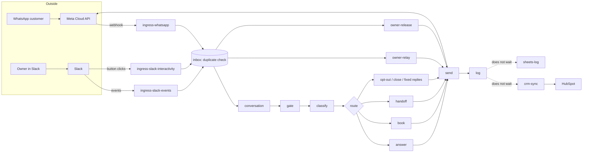

# WhatsApp agent for a cleaning company, in n8n

A WhatsApp agent for a fictional US cleaning company, built as n8n workflows on a self-hosted
instance. It answers questions from a Google Sheet the owner edits, books appointments into free
Google Calendar time, and hands the conversation to the owner in Slack when it can't go on safely.
The owner can reply to the customer from the Slack thread, and a **Return to bot** button hands the
conversation back. Enquiries and bookings go to HubSpot as a two-step deal.

The safety design is carried over from Lead Bot, an earlier Python SMS agent for a roofing company.
Plain code decides every route. A classifier (Jev, TypeSafe's classification model) answers a fixed
set of questions about each message, with a probability for each, and code applies fixed thresholds.
Claude Haiku writes a reply only when no fixed reply fits. Every draft it writes is checked by a
second Jev call and by code before it is sent.

This is a portfolio prototype on a WhatsApp test number with demo data. It is not in production use.

## Results

### Headline 1: each guard is shown to work

The replay test posts recorded webhooks into the real workflows on a dry-run copy of the instance,
where WhatsApp, Slack, Google, HubSpot and the models are replaced by a mock server, and checks what
was sent and written.

| Run | Result | What it means |
| --- | --- | --- |
| Fixed tier | **passed 54 of 54** | Model answers and AI drafts are scripted, including drafts that are bad on purpose. Every guard has at least one scenario it must catch. |
| Guard-removal run | **32 of 32 guards** caused their scenario to fail when removed | Each guard is removed in turn and its scenarios are run again. A guard counts only if removing it makes a scenario fail. |
| Live-model tier | _not run yet_ | Real Jev and Haiku calls, everything else still faked. Reported on its own, with no pass threshold, and never added to the fixed tier. |

The 32 guards are listed in [the design](docs/designs/whatsapp-agent.md#13-replay-test-dry-run-deployment-and-guards):
webhook signatures and duplicates; the gate (STOP and START keywords, do-not-contact, opt-out
phrases, owner-held and closed conversations); the classifier's hazards and its missing-field rule;
the ten draft checks; the three send rules; and the booking checks.

### Headline 2: WhatsApp delivery

| Evidence | Status |
| --- | --- |
| `docs/meta-setup.md`: every failure hit while setting up Meta's Cloud API with n8n, including failures caused on purpose | _pending_: Meta won't let the test number send until the business is verified (error 131031, see [spikes](docs/spikes.md)) |
| Hand test on the test number ([script](docs/hand-test.md)) | _pending_: passed N of M, with reply times |

## Metrics

Made by `python scripts/report_metrics.py` from the hand-test window. _Pending until the hand tests run._

| Metric | Value |
| --- | --- |
| Enquiry-to-booking rate | _pending_ |
| Cost per conversation | _pending_ |
| Throughput (busiest minute) | _pending_; events are handled one at a time, so this is the system's limit |
| Reply time, median and maximum | _pending_ |

## How it works



Events from WhatsApp and Slack go into an inbox table, and a scheduled processor handles them one at
a time, in order, under a lease. For a customer message, `conversation` runs the gate first. The gate
needs no model call. Then come the classifier, the routing rules and the stage logic. Every customer
message goes out through `send`, which checks do-not-contact, owner-held conversations and the
24-hour window. Each outside service has its own adapter workflow (calendar, Sheets, Slack,
HubSpot), and the dry-run copy swaps each adapter for a fake that calls the mock server. The live
adapters call each API with an HTTP Request node and an n8n-managed credential, so their outputs and
error codes map exactly onto the contract the fakes follow. `tests/adapter_contract.py` checks both
against that contract. Any failed run goes to the `error` workflow, which alerts the owner in Slack,
and by email if Slack itself is down.

The `doctor` workflow answers "why don't my messages reach n8n?" without sending anything. It runs
only by hand and makes read-only Graph API calls: whether the token works and has the WhatsApp
scopes, the phone number's status, quality and whether Meta will let it send (this is where the
business-verification block shows), whether the WhatsApp account is subscribed to the app (without
it, no webhooks arrive even with the callback URL set), and whether the template is approved and
still Utility. It also makes Meta's GET verify request against `ingress-whatsapp`. Its report
shows only the last 4 digits of the number and never shows a token or secret.
`tests/doctor_check.py` runs it against eight Meta accounts that the mock describes, from healthy
to locked.

The logic lives in `lib/` as plain JavaScript with unit tests. A build step copies each module into
the Code nodes that use it, so a client reading a workflow sees the code itself, with no `require` line.

## What was carried over from Lead Bot

| | What | Notes |
| --- | --- | --- |
| Carried over | Plain code decides every route; the model has no tools | |
| Carried over | Hazard questions checked in a fixed order, first match at probability 0.5 or more wins | `prompt_injection` added before `wants_human` |
| Carried over | A missing classifier field is a failed call, not a zero | |
| Carried over | Two unclear or off-topic messages in a row hand off | |
| Carried over | Opt-out phrases and the "starts with stop" rule, checked without a model call | |
| Carried over | Only offered times can be picked; number picks such as "2", "#2", "option 2" | |
| Carried over | Slot generation and slot IDs; booking checks in the order already booked, still allowed, still free | |
| Carried over | Draft blocked at Jev problem probability 0.3; only code may promise a follow-up | |
| Changed | Carrier keywords without CANCEL and END | So "cancel" about a booking doesn't opt anyone out. The classifier still catches an opt-out "cancel". |
| Changed | Draft cap 600 characters | Lead Bot's was 300, for SMS |
| Changed | Jev retries after 1 s and 2 s, then hand off | Lead Bot waited a minute; one-at-a-time handling would hold every other customer back |
| Changed | A wrong number closes the conversation | Lead Bot added it to do-not-contact. Here the owner can press **Reopen**. |
| Changed | Prices can be stated, checked per service; code calculates simple totals | Lead Bot never stated a price |
| Changed | A customer can book again | Lead Bot booked one inspection per lead |
| New | Owner relay from a Slack thread, through the business number | |
| New | Release without reset: Return to bot keeps the stage, service and address and clears only the offered times | |
| New | START and UNSTOP take a number off do-not-contact | |
| New | Prompt-injection hazard | |
| New | 24-hour window: waiting owner messages, **Send template**, **Discard waiting messages** | |
| New | HubSpot contact and deal (Enquiry, then Booked); every message also logged to a Google Sheet | |

## Words used here

*   **Relay**: the owner writes in the Slack thread, and the message goes to the customer from the business's WhatsApp number.
*   **Release**: the owner presses **Return to bot** and the bot takes the conversation back.
*   **Episode**: one handoff, from the bot handing over to the owner releasing it.
*   **24-hour window**: WhatsApp allows free-form messages only within 24 hours of the customer's last message. After that, a business can send only an approved **template message**.

## What the customer sees on release

Nothing changes on their phone when the owner presses Return to bot. The bot answers their next
message from the stage the conversation was in, with the service and address it already has. If
times had been offered before the handoff, they are cleared, so a "2" sent afterwards gets three
fresh times instead of booking an old one.

## Privacy

*   Only the author's own phone number is used; there are no real customers.
*   Full phone numbers are kept in n8n data tables, which is needed for replies. Slack posts and the
    Google Sheet log show only the last 4 digits.
*   Secrets live in n8n credentials and git-ignored env files. `npm run check` fails if a workflow file
    contains a secret pattern.
*   Only `/webhook/*` is public, behind Caddy with HTTPS. The editor is reached through an SSH tunnel.

## Limits that matter to a client

*   **One message at a time.** The measured throughput is the limit; there is no queue scaling.
*   **No rate limit and no spending cap.** One sender flooding messages slows others and raises model
    cost. Cost per conversation is measured, not capped.
*   **Some wrong prices can get past the code.** A price written in words, or an amount without "$" or "dollars", can pass the code
    checks. Jev's `unsupported_fact` check is the backstop.
*   **A 5-digit street number with no ZIP** is read as the ZIP.
*   **HubSpot search lag** can create a duplicate contact if `crm-sync` fails between creating the
    contact and storing its ID. HubSpot and the Sheets log run after the reply is sent and can't block
    it. A HubSpot failure is repaired by the next enquiry or booking.
*   **Alerts can't be answered in place.** When the facts don't cover a question or a draft is
    blocked, the customer gets a fixed line and the owner gets an alert. The owner can't reply from
    that alert.
*   **Data tables grow** until the instance's size cap; `message_log` can be cleared between test runs.

## n8n Cloud

Only the self-hosted setup has been built and tested. The classifier uses the TypeSafe AI community node
(`@typesafe-ai/n8n-nodes-typesafe-ai`). On n8n Cloud, community nodes have to be available there
before they can be installed. If this one isn't, `classify` would call Jev with an HTTP Request
node instead. Code nodes also read env values, which needs `N8N_BLOCK_ENV_ACCESS_IN_NODE=false` on
a self-hosted instance.

## Running it

Needs Docker, Node (the version in `package.json`) and Python 3.12.

```sh
npm install
npm test                                            # lib/ unit tests
npm run check                                       # lib/ copies in workflows are current; no secrets
docker compose -f deploy/docker-compose.dryrun.yml --env-file deploy/dryrun.env up -d
python scripts/setup_tables.py --instance dryrun    # data tables
python scripts/deploy_workflows.py --instance dryrun
python tests/replay.py                              # fixed tier
python tests/replay.py --remove-guards              # guard-removal run
python scripts/set_model_keys.py                    # real Jev and Anthropic keys into dry-run (hidden prompt)
python tests/replay.py --tier live                  # live-model tier
python tests/adapter_contract.py                    # live adapters against their fakes
python tests/adapter_contract.py --instance dryrun  # fakes only, against the contract
python scripts/report_metrics.py --haiku-input <usd/M> --haiku-output <usd/M>   # metrics table
python tests/doctor_check.py                        # doctor against the mock's Meta accounts
python scripts/run_doctor.py                        # doctor on the live instance (read-only)
```

The env files are described in `deploy/*.env.example`. The full design is in
[docs/designs/whatsapp-agent.md](docs/designs/whatsapp-agent.md).
